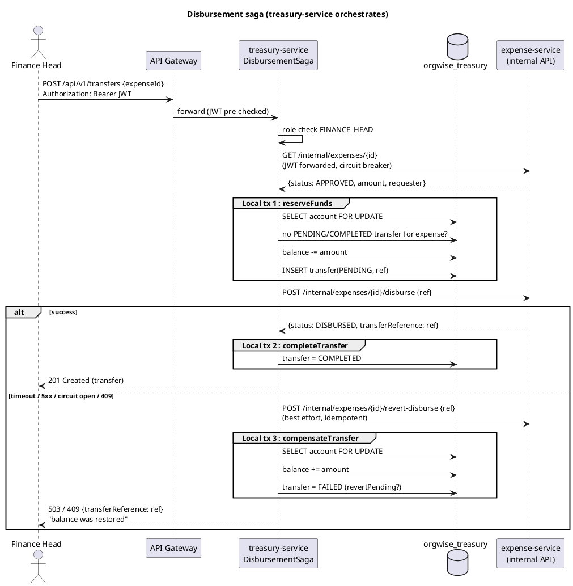

# RFC-001: Treasury sections (draft for merge)

**Author:** Lui · **Status:** Ready for merge into `RFC-001-orgwise-decomposition.md` (Rain, editor)

This file holds Lui's three parts of RFC-001: the **context #4 rationale** (§3), the
**disbursement saga** (§4), and **trade-offs** (§7). Each part can be pasted into the matching
section of the main RFC. Everything described here is implemented and tested in
`treasury-service/`; test IDs (e.g. `SG-02`) refer to `docs/test-cases/treasury-service-test-cases.md`.

---

## §3, context #4: Treasury & Ledger → `treasury-service`

**Aggregates owned:** `TreasuryAccount` (the balance) and `TransferRecord` (the append-only ledger).
Schema `orgwise_treasury`, reachable only by the `treasury_user` MySQL account.

**Why it is its own service.**

1. **Highest-integrity data in the system.** The balance is the only state in Orgwise where a bug
   means real money is lost. Its invariant ("the balance never goes negative, and each approved
   expense is paid at most once") must be protected by *one* local ACID transaction holding a
   `PESSIMISTIC_WRITE` lock on the account row (`TreasuryRepository.findByIdForUpdate`). No other
   context needs that lock, so nothing outside treasury should be able to take it or wait on it.
2. **Separation of duties.** In the monolith `TransferService.disburse` sat in the same process and
   schema as the approval workflow, so the code that *approves* spending could also *move* money.
   Splitting treasury from expense mirrors the real-world control "approver ≠ disburser". The expense
   context can only ask treasury to pay, and only the `FINANCE_HEAD` role can trigger it (checked at
   the controller with `@PreAuthorize` and again in `DisbursementSaga`).
3. **Its own audit and security boundary.** The ledger is append-only: a failed attempt stays as a
   `FAILED` row, and a retry creates a new row with a new reference. Separate credentials, a separate
   schema and a separate log stream make the ledger easy to audit and hard to tamper with from a
   compromised neighbour.
4. **Different scaling and failure profile.** Treasury handles few, short, write-heavy transactions.
   Reporting's heavy `SUM` queries no longer share its connection pool (RFC §1).

**Why it is not merged with a neighbour.**

* *Not with expense:* see point 2. Merging them would bring back the shared-table problem
  (`ExpenseRepository` used by 5 classes), and approval-policy changes would force a redeploy of the
  money-moving code.
* *Not split further:* we considered separate "Account" and "Ledger" services and rejected them.
  Debiting the balance and writing the ledger row must commit together. Splitting them would turn
  the one transaction that must be strictly ACID into a distributed one.

**Ubiquitous language inside this context:** *disbursement* (paying one approved expense),
*transfer* (one ledger row = one attempt), *reference* (UUID of a transfer, also the idempotency key
sent to expense-service), *compensation* (refunding a debit whose remote step failed). To treasury
an officer is only a *recipient* (`recipientId` + snapshot `recipientName`) or a *disburser*
(`disbursedById`, `disbursedByUsername` from the JWT).

---

## §4 Consistency across services: the disbursement saga

### Problem

In MCO1 one `@Transactional` method debited the treasury, inserted the transfer and set the expense
to `DISBURSED` (with a rollback test, `TransferRollbackIntegrationTest`). Now the expense row lives
in another service and another database, so no single ACID transaction can cover both. Two-phase
commit (XA) was rejected: it needs a transaction coordinator, holds locks across the network, and
is not supported by the Feign/HTTP style the course requires.

### Decision: an orchestrated saga with a compensating transaction

`DisbursementSaga` (treasury-service) orchestrates. Each local step commits on its own, and the
orchestrator itself is **not** `@Transactional`, so no remote call ever runs while the balance row
is locked.

| Step | Where | What | On failure |
|---|---|---|---|
| 0 | Feign → expense | `GET /internal/expenses/{id}`: must be `APPROVED` | **Fail closed**: 503 / 404 / 409, nothing changed (SG-05) |
| 1 | treasury, local tx | lock account → check "no PENDING/COMPLETED transfer for this expense" → `debit` → insert `TransferRecord(PENDING, reference=UUID)` | 409 double disbursement (SG-06), 422 insufficient funds (SG-07); tx rolls back |
| 2 | Feign → expense | `POST /internal/expenses/{id}/disburse {transferReference, amount, …}`, **idempotent on the reference** | go to 3b |
| 3a | treasury, local tx | `completeTransfer` → `COMPLETED` | (see recovery) |
| 3b | Feign → expense, then local tx | best-effort `POST …/revert-disburse` (idempotent; a no-op if step 2 never applied), then `compensateTransfer`: lock account, **refund**, transfer → `FAILED` with reason; `revertPending=true` if the revert could not be confirmed | client gets 503 (outage) or 409 (rejection) with the FAILED `transferReference` (SG-02, SG-03, SG-04) |

### Why these specific choices

* **Debit first, then call out.** Treasury reserves the money *before* asking expense-service, so a
  concurrent disbursement of another expense cannot spend the same funds while step 2 is in flight.
  Money is "held" (PENDING), never "lost".
* **Fail closed.** Every Feign fallback (`ExpenseClientFallbackFactory`) throws. None of them returns
  made-up data, so no money moves without a positive confirmation (RFC §5 resilience policy).
  Business answers (4xx) are mapped to 404/409 and configured as *ignored* by the circuit breaker, so
  a burst of "already disbursed" replies cannot open the circuit (CB-02).
* **Idempotency key = transfer reference.** If step 2 times out after expense-service applied it, a
  retry or the revert carries the same reference, so expense-service can recognise it and never
  applies it twice.
* **No double disbursement without a cross-service lock.** Every disbursement serialises on the
  single treasury account row, and the "active transfer exists?" check runs under that lock. That is
  enough, because only treasury can create transfers.

### Recovery: `PendingTransferReconciler`

A crash between steps can leave a `PENDING` transfer, or a `FAILED` one whose revert was never
confirmed. A scheduled job (every minute, configurable in the Config Server) settles both:

* **PENDING older than 2 min:** read the expense. If it is `DISBURSED` *by this reference*, complete
  the transfer. Otherwise compensate it. If expense-service is still down, leave it for the next run
  (RC-01 – RC-06).
* **FAILED with `revertPending`:** retry `revert-disburse` until it is confirmed (RC-07, RC-08).

Background calls have no user token to forward, so the job signs a short-lived JWT with role
`SERVICE` (the `FeignAuthForwardingInterceptor` falls back to it automatically).

### Consistency guarantees we can state in the defense

1. The treasury balance always equals the opening balance minus the sum of `COMPLETED` and
   `PENDING` transfers.
2. An expense is never paid twice: at most one `PENDING` or `COMPLETED` transfer exists per expense.
3. A failed saga always ends with the money back in the treasury. Expense-side cleanup is
   *eventually* consistent, and the reconciler keeps retrying it.
4. MCO1's `TransferRollbackIntegrationTest` is replaced by `DisbursementCompensationIntegrationTest`,
   which proves points 1 to 3 against a WireMock expense-service for success, 500, timeout, 409,
   connection reset, double submit and insufficient funds (SG-01 – SG-07).

---

## §7 Trade-offs we accept

| We gave up | We got | How we contain the cost |
|---|---|---|
| **One ACID transaction** for "debit + mark expense paid" | Treasury and expense deploy, scale and fail independently. Approving and paying are separate duties | Orchestrated saga with an idempotency key, a compensating transaction and a reconciler. Tests SG-01 – SG-07 |
| **Immediate consistency** between ledger and expense status | Treasury never waits on expense-service while holding a lock | A short `PENDING` window. The UI shows "Processing". The reconciler closes stuck sagas within minutes |
| **Simple failure handling** (exception means rollback) | Graceful degradation: reads in other contexts keep working when expense is down | Every money-moving fallback fails closed with a clear 503 ("No money was moved") and the FAILED transfer reference |
| **One process, one DB** | Fault isolation; least-privilege DB users (treasury cannot read `orgwise_identity`) | `docker compose` brings up 1 MySQL with 5 schemas and 5 users, plus healthcheck-ordered start-up |
| **Fast local start-up** (one JVM) | Realistic microservice topology for the course | Healthchecks plus `depends_on: service_healthy`. Each service also starts without the Config Server (`optional:configserver:`) for local debugging |
| **Shared code by import** | Independent modules | Duplication of small security helpers until `orgwise-common` lands (see handoff notes) |
| **Simpler networking** | One entry point. `/internal/**` blocked at the edge | Services are not published on host ports in compose. Only the gateway, Eureka, MySQL and the SPA are |

We accept these costs because the panel's main risks (money moved twice, money lost, one bug
taking down the whole org) are exactly the ones the split removes.
